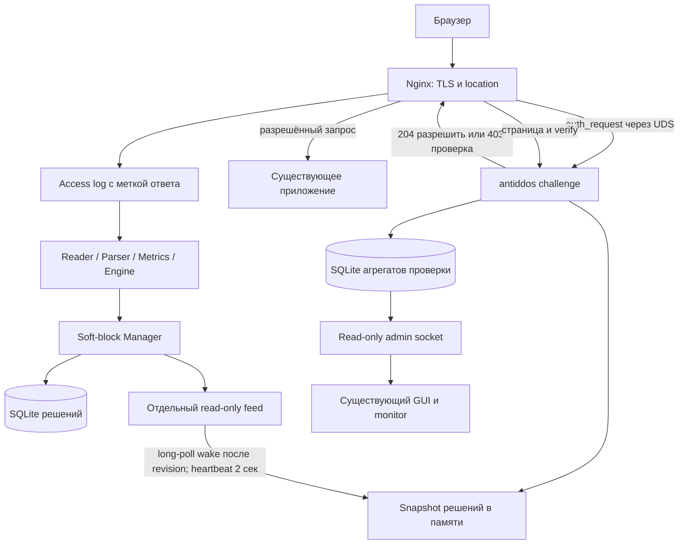

# Soft-block: окончательная спецификация и полный план реализации

Статус на 22 октября 2026: **частичная реализация; этапы B–E и UDS E2E A проверены; F прошёл в disposable Debian 13 VM с настоящим systemd; G частично начат и не закрыт**. Предыдущий Docker systemd gate оставался неуспешным, но больше не блокирует F после успешного VM gate. База исследования: `dev`, `f031b86`, релиз `v0.4.0`, исследование 20 октября, итоговая редакция 21 октября 2026. Ветка подготовки: `docs/soft-block-captcha-plan`.

Этот документ заменяет ранние варианты плана. Здесь приняты архитектурные решения; [agent-runbook](soft-block-captcha-agent-runbook.md) содержит вспомогательные промпты и команды. Прямое актуальное указание пользователя имеет приоритет; в остальном при расхождении документов действует эта спецификация. Примеры новых полей/CLI — контракт будущей реализации, не команды текущего релиза.

## 1. Как поручить всё другому агенту

Достаточно одного сообщения:

```text
В /www/antiddos выполни полностью docs/soft-block-captcha-plan.md.
Команды и задания: docs/soft-block-captcha-agent-runbook.md.
Работай автономно, последовательно A–I, включая тестирование, документацию
и финальное review. После успешного этапа переходи дальше без моего подтверждения.
Архитектуру бери из плана. Все эксперименты проводи изолированно.
Работающие сайты и службы хоста не меняй. Подготовь готовый diff и отчёт.
Не коммить, не пушь и не выпускай релиз без отдельного указания.
```

Агент сначала читает оба файла и AGENTS.md, проверяет git, создаёт/продолжает `feature/soft-block-captcha`, сохраняет незакоммиченный план и пользовательские изменения. Обновление dev не должно потерять эти файлы. Затем выполняет этапы без промежуточного согласования. После compaction/смены модели продолжает по `runtime/softblock/<run-id>/progress.md`, не начинает заново.

Объективные блокеры возможны: недоступный пакет/сеть, отсутствие разрешений для VM/container, противоречие реально наблюдаемому поведению Nginx. Агент исправляет доступные проблемы, выполняет независимые проверки и фиксирует воспроизводимый blocker. Он не объявляет незапущенные проверки успешными и не заменяет архитектуру скрытно. Это единственные основания не завершить весь объём; рутинные имена файлов и реализация методов не требуют вопросов пользователю.

Граница поручения — готовая локальная реализация с подтверждёнными проверками и инструкцией подключения. Production-install, commit, push, merge и release выполняются отдельным поручением. Полный проход включает проверку установки и удаления в disposable VM/container, а не на работающем bgt.my.

## 2. Решение человеческим языком

Существующий Nginx продолжает принимать HTTPS, использовать сертификаты и отдавать ответы приложения. Перед защищаемым запросом он спрашивает локальный сервис AntiDDoS: «Можно пропустить?» Сервис проверяет IP и cookie по памяти. Подозрительный посетитель получает страницу проверки браузера. После успешной проверки — подписанную cookie на 30 минут.

Проверка — локальный ALTCHA proof-of-work: браузер выполняет вычисление. Внешних Cloudflare/Google API нет. Это не доказательство, что посетитель человек; автоматизированный клиент тоже может выполнить вычисление. Кнопка без проверки не является реализацией защиты.

`auth_request` — модуль Nginx. Go-сервис работает отдельным процессом, Nginx обращается к нему через Unix-сокет. Lua/OpenResty и перенос TLS в наш демон не требуются. Тело обычного запроса и ответ приложения через Go не проходят, но каждый защищённый запрос требует локального HTTP-подзапроса. Накладные расходы измеряются, нулевая стоимость не обещается.

Для администратора:

1. Без soft-block установка и работа остаются прежними.
2. Optional-флаг установщика создаёт дополнительный сервис и ключи; сохраняет конфиг пользователя.
3. Администратор задаёт sites/источники, один раз подключает сгенерированные include в выбранный Nginx server/location и отдельный формат access log с меткой ответа.
4. `nginx -t` и reload активируют подключение. Далее whitelist/правила/TTL меняются в основном конфиге или GUI; `systemctl restart antiddos` применяет их и передаёт сервису проверки через feed.
5. Ключи ротируются отдельной локальной командой; после неё перезапускается challenge-сервис.

Универсального автоматического редактирования произвольных nginx.conf нет. Одна команда готовит компоненты; подключение к конкретному сайту требует осознанного изменения Nginx. Установщик объясняет точные действия и откат. GUI-флаг `--web` остаётся независимым: soft-block должен работать и без административного веб-интерфейса.

## 3. Принятые ограничения первой версии

| Область | Решение |
|---|---|
| Режим | `dry_run`, `nftables`, `soft_block` сохраняют прежнюю семантику; `hybrid` независимо выбирает `dry_run`, `soft_block` или `nftables` полем `action` каждого правила |
| Нарушитель | Только точный IPv4/IPv6 из IP-группы detection; UA/path/status остаются аналитикой |
| Область решения | Ключ `(site_id, rule_id, IP)`; разные правила и сайты независимы |
| HTTP | Проверяются GET/HEAD в явно подключённых location. Остальные методы проходят без нашей проверки; это явное ограничение MVP, не защита API/POST |
| Другие протоколы | SSH, gRPC, WebSocket upgrade, HTTP/3 и Traefik-only вне scope; upgrade явно bypass без HTML |
| Срок решения | Существующий block_duration, 1–60 минут. Повтор не продлевает активный lease этого правила |
| Иммунитет | Cookie данного host/site на 30 минут, настраиваемый TTL 1–60 минут; не снимает решение для всех клиентов одного IP |
| Whitelist | Global отменяет все решения IP; whitelist правила — только его leases |
| Источники | Несколько HTTP-логов на site; каждый источник принадлежит ровно одному site |
| Домены | Явные hosts; один host принадлежит одному site, wildcard/overlap запрещены |
| Отказ | Fail-open для отсутствующего/недоступного checker и stale feed: сайт доступен, защита ослаблена и показывает degraded |
| TLS | Production только HTTPS; cookie Secure. HTTP остаётся обычным редиректом Nginx на HTTPS |

Решение действует на все защищаемые location данного site. `path_regex` выбирает события обнаружения, а не область запрета URI. URI-specific leases в первую версию не входят. Валидная cookie разрешает новые запросы даже при новых soft-block detections до её срока. В `hybrid` отдельное nftables-правило может заблокировать тот же IP независимо от cookie.

Логирование не даёт физически мгновенную реакцию: HTTP должен завершиться, строка должна попасть в лог, а Follower — обработать её. После commit soft-решения daemon будит checker через long-poll feed без секундного ожидания. Не обещать блокировку строго шестого запроса при threshold=5.

## 4. Компоненты и путь данных



Основной daemon владеет решениями и основной БД. Отдельный непривилегированный `antiddos challenge` владеет задачами PoW, cookie-ключами и агрегатами проверки. Административный web-процесс и его users.sqlite сохраняются.

| Файл/пакет | Работа |
|---|---|
| `cmd/antiddos/cli.go` | Явный switch режима в launch; сейчас всё кроме dry_run ведёт в nftables — устранить эту ловушку |
| `cmd/antiddos/challenge.go` (новый) | Запуск checker, диагностика, генерация snippets, команды ключей |
| `internal/app/run.go` | Выбор существующего firewall Manager или нового soft Manager, жизненный цикл feed |
| `internal/softblock/manager.go` (новый) | Process/Restore/Revoke/Cleanup/Snapshot по site/rule/IP |
| `internal/softblock/feed.go` (новый) | Только чтение snapshot через отдельный UDS |
| `internal/challenge` (новый) | public HTTP mux, provider, bounded task store, cookie, snapshot reader, metrics/admin mux |
| `internal/storage/soft_blocks.go` (новый) | Leases/audit, миграция, reader для monitor/GUI |
| `internal/request`, `internal/parser`, `internal/engine` | Метка происхождения ответа; исключение служебного трафика из окон при сохранении traffic |
| `internal/config`, `internal/configservice` | sites/TTL/режим, validation, безопасное сохранение, совместимость старого JSON |
| `internal/webcontrol`, `internal/webui`, `web/src` | Новый режим, статус, soft-решения, агрегаты, авторизация admin/viewer |
| `scripts/install.sh`, `deploy` | Optional-компонент, права, snippets, safe upgrade/rollback |

Существующий Action.Remove(IP) и active_blocks по IP не переопределять под site. Новый soft Manager использует blockpolicy.Evaluate с active для своего ключа. Общий небольшой интерфейс обработчика detection допустим в app, универсальный plugin framework не нужен.

## 5. Конфигурация: один источник настроек

Предлагаемый полный пример; поле лог-маркера потребует реализации Parser и Nginx snippets:

```json
{
  "log_sources": {
    "bgt_access": {
      "path": "/var/log/nginx/bgtweb_antiddos.log",
      "format": "nginx_custom",
      "log_format": "$remote_addr - - [$time_local] \"$request\" $status $body_bytes_sent \"$http_referer\" \"$http_user_agent\" \"$antiddos_response_origin\""
    }
  },
  "database_path": "/var/lib/antiddos/antiddos.sqlite",
  "start_position": "end",
  "block_mode": "soft_block",
  "block_duration": "1m",
  "soft_block": {
    "cookie_ttl": "30m",
    "sites": {
      "bgt": {"hosts": ["bgt.my"], "log_sources": ["bgt_access"]}
    }
  },
  "engine": {
    "ignore_ips": [],
    "rules": [{"id":"homepage","log_source":"bgt_access","path_regex":"^/$","window":"5s","threshold":5,"group_by":"ip","ignore_ips":[]}]
  }
}
```

- Весь пользовательский runtime-config находится в `/etc/antiddos/config.json`. Второй редактируемый конфиг checker не создавать.
- Daemon передаёт sites/hosts/cookie_ttl/mode/config_revision в feed. После restart daemon checker атомарно принимает новые настройки вместе со snapshot. Для изменения whitelist/правил/TTL restart checker не нужен.
- У checker фиксированные пути sockets/state/credential; разрешить CLI overrides только для тестовой изоляции. Секреты не передавать через feed/CLI/GUI.
- Валидация: ссылки source/rule/site, ID `[a-zA-Z0-9_-]{1,64}`, максимум 32 sites; lowercase ASCII/punycode hosts без схемы/path/порта; TTL; обязательный origin marker для soft-источников. Остальные лимиты внутренние константы.
- Все правила в soft_block ссылаются на HTTP-источники, привязанные к site. Новый неподдержанный тип лога отклонять. Старые dry_run/nftables не требуют soft_block.
- Один лог нескольких сайтов без нормализованного host не поддерживается. Проверить это по combined автоматически невозможно; инструкция требует выделенный лог, validator проверяет только известные ссылки/формат.
- GUI сохраняет новые поля, меняет TTL/режим через существующую optimistic revision+atomic save модель. Provider profile фиксирован кодом, не пользовательским payload/JSON.

## 6. Nginx-контракт

### Подзапрос и маршруты

`/check` доступен только через internal auth location. Передавать site ID из snippet и доверенные IP/host/original URI/method/scheme; перезаписывать одноимённые заголовки клиента. Исходный method сохранить до subrequest/internal redirect. Body и Authorization не передавать; Cookie передать, не логировать.

| Случай | Ответ checker |
|---|---|
| Режим выключен, нет lease или валидна cookie | 204 |
| Подходящий GET/HEAD с lease без cookie | 403 + `X-AntiDDoS-Decision: challenge` |
| POST/PUT/DELETE/OPTIONS или upgrade | 204 + bypass reason; запрос upstream не менять |
| Неверная cookie | 403, не 5xx |
| Некорректная интеграционная metadata | 403 + `X-AntiDDoS-Decision: integration_error`, операторский сигнал |
| Неготовый/stale feed | 204 + degraded reason |

Публичные routes строго перечислены: `/__antiddos/`, `/__antiddos/challenge`, `/__antiddos/verify`, `/__antiddos/assets/...`. У них auth_request off. Public mux не содержит health, metrics, config или список IP. Они находятся на отдельном admin socket.

### Выдача страницы и fail-open

Фиксированный подход: internal error_page/named location направляет auth-403 с подтверждённым значением auth_request_set в handler страницы. Страница возвращает 429/no-store, исходный URL хранится в серверном challenge-сеансе. Другие 403 не должны выдавать нашу HTML-страницу. Не включать proxy_intercept_errors/fastcgi_intercept_errors у бизнес-upstream ради интеграции.

Поддержанные шаблоны первой версии: обычный proxy_pass и PHP try_files/FastCGI **без конфликтующего auth_request, satisfy any и пользовательского error_page 403 в защищаемом location**. Конфликт — конкретная ошибка doctor/instruction, не автоматическая переделка сайта. Проверить native deny 403 отдельно; если такой location имеет свой ответ, snippet не подключать без сохранения его поведения. Разрешение от нашей проверки никогда не отменяет авторизацию приложения.

Для отсутствующего socket, connect/read timeout и 5xx checker — fallback в **internal auth location**, возвращающий 204. Не ставить общий error_page 500 у сайта. Таймауты connect/read 200 мс, общий handler deadline 150 мс; slow-read test обязателен, proxy_read_timeout не является общим deadline.

Никакого кэширования allow/check в первом релизе. Снижение overhead достигается коротким lookup и ограничением ресурсоёмких provider endpoints.

G1: до остальных компонентов доказать этот контракт настоящим тестовым Nginx. Если конкретный шаблон не выполняет контракт, исправлять location в рамках auth_request; не переходить молча на Lua/новый proxy. Не выдавать production-конфиг до успешных tests.

### Логи и защита от повторного обнаружения заглушки

- `$antiddos_response_origin` принимает только `application`, `challenge`, `service`. Значение выставляет наш Nginx-фрагмент, пользовательский заголовок его не задаёт.
- Заглушка на исходном `/` — challenge; public служебные endpoints — service; остальные ответы, включая 429/403 самого приложения — application.
- Сгенерировать отдельный именованный custom log_format с меткой, добавляемый в http context, и предложить выделенный access_log для источника AntiDDoS. Существующие business logs сохраняются.
- Parser нормализует optional ResponseOrigin. В soft-mode для подключённого source отсутствие/неизвестная метка — parse/config error с диагностикой, не application по умолчанию. В старых режимах старый combined допустим.
- Metrics учитывает все прочитанные нормализованные события; Engine пропускает challenge/service до окон. Match-метрики должны быть явно определены: MATCHED считает application, соответствующие rule; TOTAL включает служебные события.
- Не включать лог auth subrequests как ещё один source; иначе двойной счёт. Логирование служебных locations должно сохранять общий поток без секретов/cookie/ответа задания.
- После expiry только новые application requests могут создать повторное решение. Одна выдача заглушок не продлевает проверку сама собой.

## 7. Решения, SQL и восстановление

```sql
CREATE TABLE IF NOT EXISTS soft_block_decisions (
  site_id TEXT NOT NULL,
  rule_id TEXT NOT NULL,
  source_id TEXT NOT NULL,
  ip TEXT NOT NULL,
  created_at_unix_ms INTEGER NOT NULL,
  expires_at_unix_ms INTEGER NOT NULL,
  PRIMARY KEY (site_id, rule_id, ip),
  CHECK (expires_at_unix_ms > created_at_unix_ms)
);
CREATE INDEX IF NOT EXISTS soft_block_decisions_expiry
ON soft_block_decisions(expires_at_unix_ms);
```

Отдельная additive migration, active_blocks не менять. Схема domain Key={SiteID,RuleID,netip.Addr}; lease добавляет SourceID/CreatedAt/ExpiresAt. IP canonical Unmap, zone запрещён; DNS не используется.

Методы Manager: Process(ctx,detection,now), Restore(ctx,cfg,now), Revoke(ctx,selector,now), Cleanup(ctx,now), Snapshot(now). Store: insert/list/delete/prune, транзакционная отмена. Outcome created/already_active/skipped/revoked/failed. Не называть soft created фактом firewall applied.

Порядок: policy → SQL transaction lease+audit → commit → active map → revision. Failure commit не меняет map; crash после commit восстанавливается из SQLite. При conflict активного ключа expiry не изменяется; истёкший lease заменяется новым в transaction. Два правила независимы.

Restore удаляет истёкшие, whitelisted и несовместимые с текущим rule/source/site leases; остальные сохраняют исходный expiry. На старте в dry_run/nftables старые soft leases отменяются; возврат в soft не воскрешает их. Ошибка БД — явная ошибка daemon startup.

Общий cleanup раз в минуту; lookup проверяет expiry независимо. Manager под mutex сериализует изменение; snapshot строится под короткой блокировкой без сетевого I/O. HTTP writer не держит mutex. Clock injectable, сроки UTC, интервалы monotonic.

Audit `soft_block_events`: created/expired/revoked, reason, site/rule/source/IP/time/expiry. Retention 7 дней, максимум 100000 строк, prune небольшими batch вне request path. Потеря audit при дисковой ошибке должна сопровождать failed операции, а не скрытый успех.

## 8. Feed и состояния доступности

UDS endpoint `GET /v1/soft-decisions?epoch=<opaque>&revision=<uint>`. Полный ответ содержит protocol=1, epoch, revision, mode, config_revision, sites/hosts, cookie_ttl и decisions. Unchanged-ответ не содержит массивы; принимается только с уже известными epoch/revision. Новый epoch требует полный snapshot.

- Poll 1 сек, deadline 500 мс, один запрос; ошибка backoff 1–5 сек.
- Poll — асинхронное распространение snapshot от daemon к checker. Защищённый пользовательский запрос не ждёт следующего poll: checker отвечает по уже загруженному in-memory snapshot. Интервал poll влияет на скорость вступления нового решения в силу (до примерно одного интервала после публикации feed, плюс задержка чтения/обработки access log), а не добавляет одну секунду к каждому запросу.
- На каждом защищённом запросе Nginx синхронно выполняет `auth_request` к checker через UDS. Поэтому архитектура не может обещать математически нулевую добавочную задержку: стоимость локального IPC и проверки есть всегда. Она не должна включать ожидание feed, SQLite, сети или генерации CAPTCHA. Если требуется строго нулевое влияние на latency, этот режим не соответствует требованию и включать его нельзя.
- Полная строгая валидация до atomic swap. Частичный/невалидный ответ не продлевает heartbeat.
- Максимум 50000 leases и 16 MiB body; LimitReader до allocation, bounded IDs, duplicate/IP validation. При заполнении Manager отклоняет новые leases с capacity error, не удаляет старые молча.
- Settings и решения публикуются одной версией; cookie_ttl/hosts нельзя принять от другой revision.
- В памяти checker индекс `(site,IP) → max expiry` из действующих правил; происхождение для admin отдельно.
- До первого snapshot состояние starting: fail-open. Успешный snapshot → ready. Потеря связи до 5 сек: действующие cached leases; после 5 сек: degraded+allow. Recovery валидным snapshot возвращает ready.
- Source truth времени последнего успеха — локальные monotonic часы. Изменение wall clock проверяется тестом, не освежает feed.

Важное следствие: умышленное истощение checker/daemon может ослабить защиту из-за fail-open. Это принятый приоритет доступности бизнеса, не гарантия защиты при overload. Выделенные budgets и мониторинг должны делать этот случай наблюдаемым.

## 9. Проверка браузера и cookie

Provider: self-hosted ALTCHA, официальный widget+Go library. Перед реализацией взять стабильную совместимую пару tags по официальным примерам, зафиксировать точные версии/SHA/лицензии в lockfiles и отчёте. Автоматически использовать latest в runtime нельзя. Это техническая сверка API, не выбор другой архитектуры. Внешние запросы браузера запрещены; assets локально встроены в бинарник.

Профиль вычисления фиксируется сервером и хранится в задаче; клиент не выбирает алгоритм/cost/memory/parallelism. Начальный performance target: решение ≤2 сек p95 на тестовом клиенте с 1 CPU, verify ≤20 мс p95 и ≤16 MiB временной памяти на операцию. Калибровать только численные параметры выбранного provider, записать hardware. Не принимать большие cost ради «усиления защиты» без лимитов.

Задача TTL 2 минуты, случайный nonce, привязка site/host/browser-session, серверный return URL. Для browser-session отдельная Secure/HttpOnly/SameSite=Lax cookie `__Host-antiddos_challenge`, короткий TTL; отдельный CSRF token формы. POST проверяет Origin, Content-Type, token, task existence до дорогой криптографии. Одноразовое атомарное consume: из двух verify ровно одно выдаёт cookie. При потере успешного ответа браузер проходит новое задание.

Незавершённые задачи хранятся в памяти, после restart требуется новое задание. Нельзя принимать старое задание только по HMAC после потери store. Решение PoW не вызывает global unban. Несколько вкладок используют общий короткий browser-session ID, но отдельные task nonce; не сбрасывать чужие задачи при каждом открытии страницы. При устаревшей/использованной задаче вернуть понятную ошибку и предложить новую.

Иммунитет: `__Host-antiddos_pass`, Secure/HttpOnly/SameSite=Lax/Path=/, без Domain. HMAC-SHA256, 32 random bytes, constant-time compare. Фиксированный формат version/key_id/site_id/host/issued_at/expires_at/random_id; алгоритм из payload не выбирается. Размер token ≤4096 bytes; строгий decode/claims/time check. Возраст учитывает текущий cookie_ttl: уменьшение TTL сокращает допустимый возраст уже выданных cookie, увеличение не продлевает подписанный expiry. Допустимый future clock skew 30 сек.

Cookie без IP/UA binding; это выбранный компромисс для мобильных сетей. Украденный token пригоден до expiry, cookie не защищает сайт от XSS. Несколько hosts одного site проверяются по разным host audiences. Host не может принадлежать двум sites.

Отдельные ключи cookie и provider. Секреты root-owned `/etc/antiddos-challenge/keys.json` mode0600 в root-owned каталоге 0700; checker получает их через systemd LoadCredential, не читает каталог основного конфига. При ротации старый cookie-key принимается максимум 60 минут, новый используется для выдачи. Команда аварийной ротации не сохраняет предыдущий ключ. После rotation restart challenge; задачи памяти пропадают, действующие cookie старого ключа сохраняются только при grace.

Return URL только локальный путь, без `//`, scheme, CR/LF, backslash и encoded вариантов обхода; нормализация и проверка до хранения и перед 303. Никакого автоматического replay POST. HTML escaping, no-store, CSP с минимальными разрешениями для локального widget/worker, запрет framing. JS-disabled клиенту показать понятное объяснение; не выпускать cookie без PoW.

## 10. Лимиты ресурсов и горутины

Checker: один feed poll loop, один maintenance loop, HTTP server goroutines. Manager: один cleanup loop плюс feed HTTP server. Ни таймера, ни goroutine на IP/задачу. Shutdown cancel context → HTTP Shutdown 5 сек → ограниченный flush метрик → close DB.

- 10000 незавершённых задач глобально; 3 на site/IP; 5 выдач и 10 verify в минуту на site/IP.
- Bounded limiter map: 20000 ключей, idle TTL 5 минут; при заполнении новый ключ использует ограниченный общий бюджет, не выделяет память без лимита.
- Verify/create semaphore: min(2×GOMAXPROCS, 8, memory_budget/per_operation_bound); memory budget 64 MiB. Без очереди ожидания — 429 при отсутствии слота.
- Public form body ≤16 KiB; headers ≤16 KiB; max header read 2 сек, create/verify handler deadline 2 сек. `/check` budget короче, см. раздел 6.
- Не более 256 одновременных public connections; тяжёлые операции ограничены независимо. Административный socket отдельно, bounded range/page size.
- Если provider не умеет отменять вычисление, context не освобождает semaphore до фактического завершения. Предел работы гарантируется серверными параметрами и входным payload validation.
- `/check` не читает SQLite, не ждёт генерацию задания и не отправляет синхронный RPC.

## 11. Права, sockets и установка

| Путь | Владелец:группа и режим | Доступ |
|---|---|---|
| `/run/antiddos-soft-feed` | antiddos:antiddos-soft-feed 0750 | daemon + challenge |
| `.../feed.sock` | antiddos:antiddos-soft-feed 0660 | Только read-only feed |
| `/run/antiddos-challenge-check` | antiddos-challenge:antiddos-check 0750 | checker + Nginx worker |
| `.../check.sock` | antiddos-challenge:antiddos-check 0660 | Check и public routes |
| `/run/antiddos-challenge-admin` | antiddos-challenge:antiddos-challenge-read 0750 | checker + daemon/web |
| `.../admin.sock` | antiddos-challenge:antiddos-challenge-read 0660 | Health/агрегаты, только чтение |
| `/var/lib/antiddos-challenge` | antiddos-challenge:antiddos-challenge 0700 | metrics.sqlite |

Группы создаёт installer; Nginx не добавляется в antiddos, только в antiddos-check. Runtime-каталоги создаются systemd/tmpfiles с указанным ownership; service может chgrp своего socket только на назначенную supplementary group. Проверить фактический traverse/connect и отрицательные попытки доступа. Доступ к UDS определяется правами, доступ к административным HTTP routes не определяется одним URL prefix.

Checker unit: User=antiddos-challenge, CapabilityBoundingSet= и AmbientCapabilities= пустые, NoNewPrivileges, ProtectSystem=strict, ProtectHome, PrivateTmp/Devices, AF_UNIX, StateDirectory, ограниченные read/write paths. LoadCredential для ключей. Секреты не печатать.

Базовый daemon unit допускает CAP_NET_ADMIN, потому что один и тот же установленный профиль должен поддерживать nftables-действия. Launcher сохраняет capability только если хотя бы одно эффективное правило использует `nftables`; иначе сначала снимает оставшиеся leases прежней конфигурации и затем запускает анализатор без capability. Checker всегда запускается без capabilities. Soft-block drop-in настраивает только группы/feed.

Nginx Docker: bind-mount **каталог check socket** в фиксированный путь, numeric supplementary GID, без privileged, без полного /run. Тестируется reconnect после recreate socket. Docker rootless/SELinux/AppArmor при несовместимости — диагностируемое unsupported окружение, не chmod777. Traefik-only адаптер не реализуется.

## 12. Статистика и GUI

Основная БД хранит soft leases/audit; checker хранит только агрегаты в своей metrics.sqlite. Никакой записи каждой проверки в SQLite: counters в памяти, flush каждые 2 секунды. Bucket 2 сек, site и фиксированная причина, retention 7 дней; число sites ограничено. Ошибка metrics DB включает degraded metrics, но не меняет решение `/check`. Очередь flush bounded, потерянные агрегаты считаются; не накапливать бесконечно при full disk.

Admin socket предоставляет GET `/v1/status` и GET `/v1/metrics?from=&to=&limit=` с диапазоном максимум 7 дней и limit≤1000. Основной daemon проксирует ограниченный read-only запрос через существующий webcontrol, web-процесс сохраняет admin/viewer проверку. Admin endpoint checker валидирует каждый параметр независимо от доверия группе socket. Monitor использует тот же reader/service; отсутствие checker не ломает существующую статистику.

Реализовано в checker: отдельная SQLite, агрегаты за 2 секунды, сохранение при остановке и read-only admin endpoint. Старые 15-секундные bucket остаются читаемыми как исторические строки. `from` и `to` задаются в RFC3339, интервал полуоткрытый `[from, to)`, `bucket` в ответе — Unix seconds. `issued` считает созданные задачи, `solved` — выданные после успешной проверки cookie, `rejected` — отклонённые формы verify с распознанным site (при невалидных metadata site неизвестен), `immunity` — пропуски по валидной cookie. `fail_open` с site `global` учитывает только запросы, которые checker сам пропустил из-за отсутствия feed; при недоступном checker число неизвестно. Данные последнего интервала появляются после flush; `metrics_health` и `metrics_dropped` доступны в status, потерянные агрегаты после перезапуска не сохраняются. Daemon проксирует status и ограниченный запрос метрик; monitor показывает записи за 15 минут, GUI — за час и обновляет challenge-данные раз в 2 секунды. Запросы ограничены 1000 строками, GUI сообщает о возможном усечении.

GUI: режим, saved/running revision, site/source/rule/expiry; issued/solved/rejected/immunity/fail_open; freshness и readiness отдельно. Не показывать soft leases как firewall bans. Admin меняет режим/TTL/whitelists/regex, viewer только читает. Кнопки shell/restart/Nginx-edit не добавлять. Команда применения сохраняется в подсказке.

TRAFFIC отражает ответы Nginx, включая заглушки; это не только байты приложения. В fail-open из-за полностью упавшего checker он сам не может посчитать пропуски: Nginx интеграционный diagnostic log фиксирует их. GUI показывает «недоступен, точное число bypass неизвестно», а не выдуманный ноль.

## 13. Полный административный жизненный цикл

### Установка и подключение

Команда preview реализована; генерация файлов через `--write` пока является только подготовкой для ручной проверки, не подтверждённым production-подключением. Read-only `soft-block doctor` проверяет конфиг/site, тип и режим сокетов, build flags Nginx; опциональное `--nginx-config` делает только текстовый поиск очевидных конфликтов и не является полноценным парсером. Installer поддерживает установку локального soft-block профиля (`--soft-block`): units, служебные группы и первый private credential; повторная установка сохраняет ключи. В disposable Debian 13 VM прошли `--no-start` и повторный запуск с systemd units. Installer пока не меняет сайт-конфиг Nginx, не завершает disable/rollback и не проверяет миграцию из nftables. Команду можно вызвать из собранного бинарного файла:

```sh
sudo bash scripts/install.sh --local --soft-block
sudo antiddos nginx-snippet --site bgt --output /etc/nginx/snippets/antiddos-bgt --write
sudo nginx -t && sudo systemctl reload nginx
```

Команда preview принимает также `--config`; без `--write` печатает содержимое шести файлов и ничего не создаёт. С `--write` файлы создаются только в указанном каталоге; существующие файлы не перезаписываются. Она не меняет активный конфиг и не делает reload. До использования на рабочем сайте нужны проверка с реальным Nginx и review пересечения существующих location, `add_header`, `auth_request` и `error_page`.

Проверка предпосылок без вывода полного Nginx config:

```sh
antiddos soft-block doctor --site bgt
antiddos soft-block doctor --site bgt --nginx-config /etc/nginx/nginx.conf
```

Doctor не открывает/перечитывает конфигурацию сам, если `--nginx-config` не задан. Текстовый поиск может дать ложное совпадение в комментарии и не доказывает отсутствие конфликта в подключённых файлах или выбранном location; итоговые `nginx -t` и реальная тестовая страница остаются отдельными gate.

Installer ставит сервис/группы/ключи и сохраняет config, не подключает сайт. Он не включает `block_mode: soft_block` автоматически. Вывод генератора содержит include для http/server/location, строки выделенного access_log и инструкции. Nginx worker должен быть членом `antiddos-check`; installer пока сообщает это требование, но не меняет группу неизвестного ему worker user. Перед активацией администратор проверяет фактический worker user, применяет нужное членство группы, вручную вставляет include, выполняет `nginx -t`, затем reload. Документация не должна называть preview установленным подключением.

Будущие расширения doctor: разбор всех подключённых конфигов Nginx без вывода секретов и точная диагностика conflicts, ownership/group доступа для ожидаемых пользователей и mode/revision feed. Текущая ранняя команда не проверяет эти свойства и не гарантирует выбранный location; одной команды nginx -t также недостаточно. Локальный проверочный сценарий выполняется отдельно. Полный nginx -T с секретами не печатать.

### Переход из nftables

Простая безопасная процедура без новой привилегированной сетевой команды в daemon:

1. Пока старый daemon работает, изменить config на soft_block (подготовить sites/snippets).
2. Installer останавливает daemon и проверяет отсутствие других процессов-владельцев managed table.
3. Root installer читает и валидирует ownership/schema нашей таблицы, снимает только наши элементы/собственную таблицу; фиксирует результат. Чужие ruleset не трогает. Ошибка проверки ownership останавливает переход.
4. Только после успешного удаления firewall-состояния отменяет соответствующие active_blocks записи через отдельную offline maintenance команду при остановленном daemon. При ошибке БД не объявляет переход завершённым.
5. Ставит checker/feed profile, запускает daemon/checker; launcher снимает CAP_NET_ADMIN согласно выбранному режиму; doctor; затем администратор активирует Nginx snippet.

Повтор installer идемпотентен после частичного сбоя. Если nft отсутствует/таблица не проверена, не сообщать «сняты все блокировки». Не вызывать flush ruleset. Тестировать в disposable VM/network namespace.

### Выключение, обновление, откат

- Временное выключение: dry_run + restart daemon; feed публикует disabled, leases отменяются. Checker остаётся для allow ответов, подключение Nginx не меняется.
- Полное удаление: убрать наши include/access_log, nginx -t/reload, затем stop/disable checker. Основной daemon/БД/GUI по желанию остаются. Статистику и ключи не удалять автоматически.
- Upgrade: сохранить config/keys/users, атомарно заменить бинарник, restart units; versioned feed и диагностируемый краткий fail-open. Повторный installer не генерирует новый ключ.
- Rollback бинарника v0.4.0: сначала убрать Nginx integration и выставить поддерживаемый режим; сохранить копию нового JSON, удалить новые поля из rollback-конфига. Старый decoder строгий и иначе не запустится. Additive soft-таблицы не удалять, они сохраняют данные.
- Ошибка nginx -t: никаких reload/restart, старый worker обслуживает сайт; инструкция вернуть только изменённые include.
- Ротация ключей: `sudo antiddos challenge-keys rotate` / `rotate --revoke-existing`, атомарный root-owned файл, затем `sudo systemctl restart antiddos-challenge`.

## 14. Этапы полного автономного выполнения

| Этап | Объём и выходной результат | Условие перехода |
|---|---|---|
| A | Изолированный настоящий Nginx+настоящий checker через UDS+upstream; HTTPS, proxy/FastCGI, ALTCHA browser flow, 403/fail-open/log-marker | Все контракты раздела 6 доказаны; runner чистит свои PID |
| B | Config/ConfigService/Parser/Event/Engine, метки, legacy совместимость | Старые конфиги и новый пример, round-trip GUI save, исключение служебных событий |
| C | SQL migration, soft Manager, restore/revoke/audit | Транзакции, expiry, whitelist, два site/rule, fault injection и race |
| D | Feed, атомарный cache, состояния starting/ready/degraded/disabled | Epoch/revision/partial/stale/recovery/capacity, benchmark lookup |
| E | Provider+локальные assets+cookie+CSRF+лимиты | Реальный HTTPS browser e2e, replay/host/cost/rotation и ресурсные бюджеты |
| F | CLI/app lifecycle, launcher, sockets, units, capabilities | PASS в disposable Debian 13 VM: start/restart/stop, LoadCredential, права UDS, capabilities, read-only config/DB; см. `runtime/softblock/20261022-vm-local-install-01/progress.md` |
| G | Installer/snippets/doctor/upgrade/disable/rollback | Частично: `--soft-block` install/no-start/reinstall и key preservation прошли в VM; preview/doctor написаны, generated config прошёл `nginx -t` и HTTPS UDS challenge. Disable/rollback, полный release archive, миграция nftables и полная installer матрица ещё не закрыты |
| H | Monitor/GUI/агрегаты/admin API | Admin/viewer, saved/running, no-checker degraded, сохранность прежнего dashboard |
| I | Сквозная матрица, нагрузка, soak, README и review | Артефакты всех проверок, runnable quickstart и итоговый diff |

Следующий этап начинается после критериев предыдущего, без вопроса пользователю. Провал теста исправляется до продвижения. Временный блокер среды не разрешает назвать этап завершённым. Промпты в runbook — детализация действий, не требование завершать всю сессию после этапа.

Базовые команды: `go test ./...`, `go test -race ./...`, `go vet ./...`, сборка CLI; frontend `npm ci`, `npm run build`, `npm run test:e2e` в web. Race/SQLite требуют CGO/toolchain. Не запускать отдельно старый serve.mjs; Playwright управляет им. Скрипт production `scripts/soak-test.sh` для этой работы запрещён.

Тестовая среда: сначала использовать доступный локальный Nginx с отдельным prefix/конфигом и непривилегированными портами. Для FastCGI и unit/install подготовить disposable container/VM fixture с Nginx, PHP-FPM, nftables и systemd; не ставить их на рабочий хост. Зафиксировать образ digest и версии пакетов в отчёте. Если systemd невозможно запустить в container, использовать VM; проверки unit не заменять только чтением файла.

Этап A создаёт `tests/integration/softblock/run.sh`; I расширяет его и добавляет soak.sh. CLI runner указан в runbook, output-dir должен быть новым. Изолированные порты и PID manifests; cleanup traps на success/failure/signals; никаких pkill по общему имени и нагрузок bgt.my.

## 15. Матрица обязательных проверок

| Область | Сценарии |
|---|---|
| Nginx | 204/403; original method/URI; internal redirects; upstream 401/403/429/500 неизменны; no auth loop; forged headers; denied internal route; body POST сохранён и bypass явно показан |
| Логи | Application/challenge/service; app 429 не исключается; заглушка на `/` исключается; TOTAL/MATCHED; subrequest без двойного счёта; buffered flush; rotation |
| Решения | IPv4/IPv6/mapped; non-IP skip; два site; два rules; repeat без продления; expiry до cleanup; whitelist разного уровня |
| Restore/DB | Restart с исходным expiry; deleted rule/source/site; read-only/full disk; crash после commit; stale map; additive migration; mode switch |
| Cookie | Подпись/claims/host/site/TTL/key_id tamper; clock skew; duplicate/oversize cookie; TTL change; rotation; JS недоступность; host-only |
| Задача | CSRF/Origin; replay/двойной POST; server-side params; huge cost/payload; browser session mismatch; TTL; restart; потеря verify response |
| Ресурсы | Task/limiter capacity; NAT; semaphore; cancellation; slow auth response; connections/FD; bounded metrics queue |
| Feed | New epoch; unchanged mismatch; partial/oversize JSON; sites settings atomic; 5 сек stale; recovery; disabled/starting |
| Права | Nginx не читает admin/feed/key; challenge не пишет основной config/DB и не вызывает nft; GUI roles; metadata не даёт приватные endpoints |
| Установка | Existing config/users; повтор install; нет модуля; занятый route; nginx -t fail; upgrade; disable; rollback; nftables migration; Docker reconnect |

Имена обязательных e2e: allowed_without_decision, threshold_to_challenge, solve_then_allow, cookie_not_global_unban, site_isolation, multiple_rules, expiry_without_cleanup, restart_preserves_expiry, provider_replay, feed_outage, upstream_errors_preserved, request_body_preserved, disabled_compatibility, mode_switch, challenge_does_not_renew_itself.

Для cookie нужен реальный HTTPS браузер, для Nginx — реальный Nginx, для firewall lifecycle — изолированная реальная nftables-среда. Mock допустим только в unit tests, не заменяет сквозной критерий.

## 16. Нагрузка и определение готовности

Сначала подобрать baseline статического upstream на выделенной тестовой среде: ступени 100/500/1000 RPS по 60 сек; выбрать максимальную с CPU<70%, errors<0.1%. Если даже 100 RPS недоступны, зафиксировать ограничение среды; не заявлять промышленную производительность. Сравнивать baseline и auth_request allow path при одинаковой нагрузке; измерять именно добавочную latency и ошибки. Цель плана — добавочный p95≤2 мс и p99≤5 мс, это измеряемый бюджет, а не обещание нулевой задержки. Если бизнес-требование означает строго 0 мс добавки, gate архитектурно не может быть пройден.

На выбранном RPS сравнить Nginx baseline / allow lookup / cookie / challenge / outage: p50/p95/p99, errors, CPU/RSS/live heap/GC/goroutines/FD, очереди, размер DB, elapsed decision propagation. Целевой добавочный p95≤2 мс, p99≤5 мс, без новых ошибок на стабильной нагрузке. Если не выполнено — профиль и исправление в текущей архитектуре, затем повтор только затронутого замера.

Soak 40 минут, затем 6 часов: steady 20% выбранного RPS, каждые 30–60 сек seeded всплеск 80% на 2 сек. Отдельно слабый браузер и verification overload. Seed/target/versions сохраняются. В soak заложить restart, expiry, whitelist, log rotation и feed outage по расписанию. CPU/RSS раз в секунду; live heap/профили отдельными периодическими точками через **локальный тестовый** интерфейс, production pprof не публиковать.

RSS сам по себе не доказывает утечку. Проверить live heap после GC, удерживаемые leases/tasks, limiter entries и FD/goroutines после возврата к baseline. Зафиксировать потерянные samples и gap при restart.

Артефакты в `runtime/softblock/<run-id>`: environment.json, commands.log с exit codes, sanitized config, requests/metrics.csv, CPU/heap profiles, nginx/daemon/checker logs, browser traces и report.md. Не сохранять cookie/ключи/ответы задач. README содержит только реально работающие команды и отдельный optional-раздел.

Работа завершена, когда A–I закрыты, весь checklist выполнен, test processes остановлены, рабочие сервисы пользователя не затронуты, подготовлены diff и итоговый отчёт. Нельзя писать «готово», если вместо реального сценария был только mock или шестичасовой тест ещё выполняется. Оценка полного объёма 8–14 рабочих дней; фактическое время зависит от среды и найденных дефектов.

### Следующее развитие: два уровня защиты и быстрая доставка решений

Это согласованное расширение после текущего MVP. Оно снимает ограничение одного глобального действия на все правила и сокращает задержку отображения метрик и применения soft-block. Оно не меняет задним числом требования к совместимости `dry_run`, `nftables` и `soft_block`.

Статус 23 октября 2026: первая локальная итерация реализована. Config/API/GUI понимают `hybrid`, dispatcher направляет правила в разные менеджеры, feed использует revisioned long-poll с двухсекундным heartbeat, метрики и GUI переведены на 2 секунды. Изолированный E2E подтверждает одновременную запись firewall lease и soft lease и wake checker менее чем за 500 мс. Нагрузочный p99≤100 мс, установка обновления на хост и полный systemd/nginx gate ещё не выполнены.

#### Независимые действия в одном конфиге

Режим `hybrid` и поле `action` у правила принимают `dry_run`, `soft_block` или `nftables`. Старые конфиги без `action` сохраняют прежнюю семантику глобального `block_mode`. В `hybrid` каждое правило обязано явно задать действие; неявное действие и неизвестные значения отклоняются валидатором. Наличие всех трёх типов не требуется.

Пример желаемой настройки:

```json
{
  "block_mode": "hybrid",
  "engine": {"rules": [
    {"id":"audit-only","action":"dry_run","log_source":"audit_access","path_regex":"^/","window":"10s","threshold":8,"group_by":"ip"},
    {"id":"captcha-level","action":"soft_block","log_source":"bgt_access","path_regex":"^/","window":"10s","threshold":8,"group_by":"ip"},
    {"id":"firewall-level","action":"nftables","log_source":"bgt_access","path_regex":"^/","window":"1s","threshold":10,"group_by":"ip"}
  ]}
}
```

Обе подходящие политики вычисляются независимо по своим окнам и сохраняются в detections. При достижении нижнего порога создаётся CAPTCHA lease для site/IP. При достижении жёсткого порога применяется nftables ban; firewall становится итоговым действием для этого IP, а уже созданный CAPTCHA lease не должен создавать впечатление, что браузер сможет пройти проверку сквозь сетевой бан. После окончания firewall ban действующий soft lease снова требует CAPTCHA до своего expiry. Whitelist и ошибки применения каждого action отображаются отдельно. Это правило приоритета нужно явно показать в документации и интерфейсе.

Такой пример не обещает, что десять запросов за одну секунду вызовут только firewall: они также удовлетворяют окну 8 за 10 секунд. В этом случае сработают обе политики, а firewall будет сильнейшим действием. Нагрузочные проверки должны подтвердить независимость окон, запись двух detections и корректный переход firewall ban → оставшееся CAPTCHA-решение.

Реализация: расширить config schema/API/GUI, dispatcher в `internal/app`, разделить обработчики firewall и soft Manager, сохранить раздельные таблицы решений (`active_blocks` и `soft_block_decisions`) и общий аудит с типом действия. Правила nftables должны продолжать требовать точный IP group; soft-block дополнительно требует привязку источника к site. Переключение старых режимов и миграции не должны незаметно удалять активные firewall rules или soft leases.

#### Доставка решения в checker без секундного polling

Сохранить SQLite основным источником истины и оставить snapshot feed для первичной загрузки и восстановления после перезапуска/разрыва соединения. Для рабочего пути заменить ожидание следующего секундного poll на revisioned long-poll/push через существующий приватный Unix feed:

1. Daemon атомарно сохраняет/обновляет soft lease в SQLite и увеличивает revision.
2. После commit он будит ожидающий feed запрос. Feed возвращает актуальный snapshot (или ограниченный delta с revision); checker применяет его атомарно к in-memory state.
3. При разрыве checker переподключается и получает полный snapshot. Пропуск revision также заставляет запросить snapshot; дублированная revision безопасна.
4. Пока активного запроса нет, не создаются фоновые polling-запросы. У feed есть heartbeat/таймаут, ограничение числа ожидающих клиентов и штатная отмена при остановке.

Так checker узнаёт о зафиксированном нарушении сразу после обработки access-log event и commit решения, без ожидания до следующего секундного poll. Это не устраняет задержку до появления строки в access log и чтения её daemon; целевой и измеряемый бюджет отдельно фиксируется от момента detection до применения snapshot. Текущий fail-open для недоступного/stale feed сохраняется.

#### Метрики с двухсекундной гранулярностью

Уменьшить bucket и периодический flush checker metrics с 15 секунд до 2 секунд, а период обновления challenge status/metrics в GUI — также до 2 секунд. Проверить, что частые короткие SQLite транзакции не блокируют обработчики запросов: запись остаётся вне request path, batch bounded, flush имеет timeout, ошибки/потери видны в `metrics_dropped` и health.

Изменение требует миграции чтения старых строк метрик: существующие Unix timestamps 15-секундных bucket оставить читаемыми как исторические записи, новые записи выравнивать по 2 секундам. Нельзя переинтерпретировать старые bucket или агрегировать один и тот же период дважды. При штатной работе верхняя граница ожидания записи новой метрики — около 2 секунд, после чего добавляется интервал обновления GUI и время запроса. Это задержка наблюдаемости, она не участвует в применении CAPTCHA.

#### Порядок работы и критерии приёмки

1. Сначала сделать отдельный action per rule и hybrid dispatcher: unit/config tests, затем изолированный nftables network namespace и CAPTCHA e2e. Проверить legacy-конфиги, whitelist, restart/expiry, одновременное совпадение двух правил, ошибки nftables и фактическое применение/снятие только принадлежащих AntiDDoS firewall entries.
2. Затем заменить polling доставки soft решений revisioned long-poll/push: тесты задержки, race между commit и подпиской, reconnect, пропуск/дубль revision, рестарт checker, shutdown и stale/fail-open. Сквозной критерий: измерить commit→checker-apply; целевой p99 ≤100 мс на локальном хосте под согласованной нагрузкой.
3. Затем перейти на двухсекундные метрики/GUI refresh: тесты bucket boundaries, restart и сохранение старых метрик, SQLite contention и нагрузка; критерий — новая строка доступна для API максимум через 2 секунды после записи события плюс один GUI refresh-интервал.
4. Обновить конфигурационный пример, админскую памятку, GUI пояснение приоритета и отчёт измерений. Не включать новый hybrid mode при upgrade автоматически; администратор явно назначает action правилам.

Весь путь detection → log write → parse/evaluate → DB commit → feed wake → checker apply измерять отдельно. Формулировка «без задержек» означает отсутствие секундного polling ожидания после commit, а не физически нулевое время реакции от HTTP-запроса.

### Финальная передача результата

Агент сохраняет `runtime/softblock/<run-id>/report.md` с таблицей A–I: completed/failed/blocked, команда воспроизведения и ссылка на артефакт. Отдельно — install/upgrade/disable/rollback, версия provider, измеренная нагрузка и оставшиеся ограничения. Приложить `git diff --stat`, перечень новых/untracked файлов и команду локальной сборки. Не ограничиваться git diff: новые файлы до git add могут не попасть в вывод.

В `docs/soft-block-operations.md` создать короткую проверенную шпаргалку администратора: установка release и local build, настройка sites/logs, include, проверка, включение, whitelist/TTL, отключение, rollback и диагностика. В README оставить краткий optional quickstart со ссылкой на неё. Все новые бинарные assets должны попасть в release archive через существующий workflow; проверить состав архива локально. Изменение workflow проверяется без создания тега или публикации релиза.

## 17. Продуктовая модель и расширение источников

### Что есть сейчас

AntiDDoS работает как daemon с SQLite, Nginx checker и локальным web UI. Конфиг задаёт источники логов, правила и действие каждого правила.

| Режим | Поведение |
| --- | --- |
| `dry_run` | Только наблюдение и detections, без блокировки |
| `soft_block` | CAPTCHA через Nginx `auth_request`, checker и cookie прохождения |
| `nftables` | Реальная блокировка IP на заданных TCP-портах |
| `hybrid` | Независимые `dry_run`, CAPTCHA и nftables для разных правил |

Типовой путь администратора: установить release/local binary, проверить JSON, указать log sources и rules, для soft-block сгенерировать Nginx snippets, проверить `nginx -t`, перезапустить systemd services и начать с `dry_run`. После проверки паттернов админ включает soft-block или nftables явно, с учётом того, что nftables блокирует IP на сервере, а не только на одном host.

### Поддержка логов: текущая граница

Сейчас надёжно поддерживаются `nginx_combined` и `nginx_custom`. Этого достаточно для анализа access-log и большинства HTTP-атак. SSH auth log, Nginx error log и сетевые события нельзя корректно скормить как HTTP access event без нового parser/event schema.

`auth.log` не хранится в `/var/log/nginx`: на Debian/Ubuntu обычно используется `/var/log/auth.log`, на RHEL/CentOS — `/var/log/secure`, а на системах с journald источником может быть `journalctl -u ssh` или `journalctl -u sshd`. Путь и формат нужно подтвердить на хосте, а не предполагать.

### Roadmap после капчи

1. Запросить у Ивана реальные access/error/auth/firewall логи, засанитайзить IP, cookies, usernames и payloads, зафиксировать формат и временные зоны.
2. На access-log сначала добавить detection-only правила: HTTP brute force, path traversal, SQLi/XSS подозрительные URL, массовые 404/403, endpoint scan и аномальные user-agent.
3. Добавить `syslog_sshd`/расширенный journald parser для `Failed password`, `Invalid user`, PAM failures и нормализовать их в `event_type=ssh_failed_login`, IP, user и service. Regex Fail2ban `sshd` использовать как справочник, но валидировать на реальном логе.
4. Добавить `nginx_error` parser для upstream failures, auth errors и backend anomalies; не смешивать error events с HTTP access requests.
5. Для port scan подключить firewall/Netfilter/conntrack или Zeek/Suricata как сетевой source. Access-log один не даёт надёжного port-scan detection.
6. Для каждого нового source сделать sample logs, parser tests, normalized event tests, dry-run replay и отдельную цветную линию на графике.
7. Не включать реальный nftables для новых атак до того, как прогон на санитайзированных логах покажет нет ложных срабатываний.

### Опциональное подключение source

Каждый новый класс событий должен включаться отдельно в `log_sources`; его отсутствие не должно менять поведение access-log и Nginx checker. Планируемые форматы:

```json
{
  "log_sources": {
    "bgt_access": {"path": "/var/log/nginx/bgtweb_access.log", "format": "nginx_combined"},
    "bgt_error": {"path": "/var/log/nginx/error.log", "format": "nginx_error"},
    "ssh_auth": {"path": "/var/log/auth.log", "format": "syslog_sshd"},
    "netfilter": {"path": "/var/log/kern.log", "format": "netfilter_log"}
  }
}
```

`bgt_error`, `ssh_auth` и `netfilter` не добавлять в рабочий конфиг до реализации и парсер-тестов. `syslog_sshd` будет выделять `Failed password`, `Invalid user` и PAM failures; `netfilter_log` должен описывать сканирование портов по сетевым событиям, а не по access-log.

## 18. Источники и границы уверенности

- [Nginx auth_request](https://nginx.org/en/docs/http/ngx_http_auth_request_module.html): статусы подзапроса, сборка модуля, auth_request_set.
- [Nginx core](https://nginx.org/en/docs/http/ngx_http_core_module.html#error_page): error_page, location и внутренние переходы.
- [Nginx proxy](https://nginx.org/en/docs/http/ngx_http_proxy_module.html): Unix proxy_pass, тело и таймауты.
- [Nginx logs](https://nginx.org/en/docs/http/ngx_http_log_module.html): формат, access_log и buffer.
- [Nginx real IP](https://nginx.org/en/docs/http/ngx_http_realip_module.html): доверенные прокси. Только явный trusted proxy, не любой X-Forwarded-For.
- [ALTCHA widget](https://github.com/altcha-org/altcha), [Go library](https://github.com/altcha-org/altcha-lib-go): локальный PoW и верификация; совместимые версии фиксируются в реализации.
- [OWASP session management](https://cheatsheetseries.owasp.org/cheatsheets/Session_Management_Cheat_Sheet.html): cookie boundaries, срок и защита токенов.
- [CrowdSec Nginx bouncer](https://docs.crowdsec.net/u/bouncers/nginx/): пример разделения detection/remediation; его Lua-интеграция не копируется в этот проект.

Документация подтверждает примитивы, но не доказывает безопасность комбинации наших snippets. Архитектура здесь выбрана; интеграционные проверки являются обязательным доказательством конкретной реализации.
